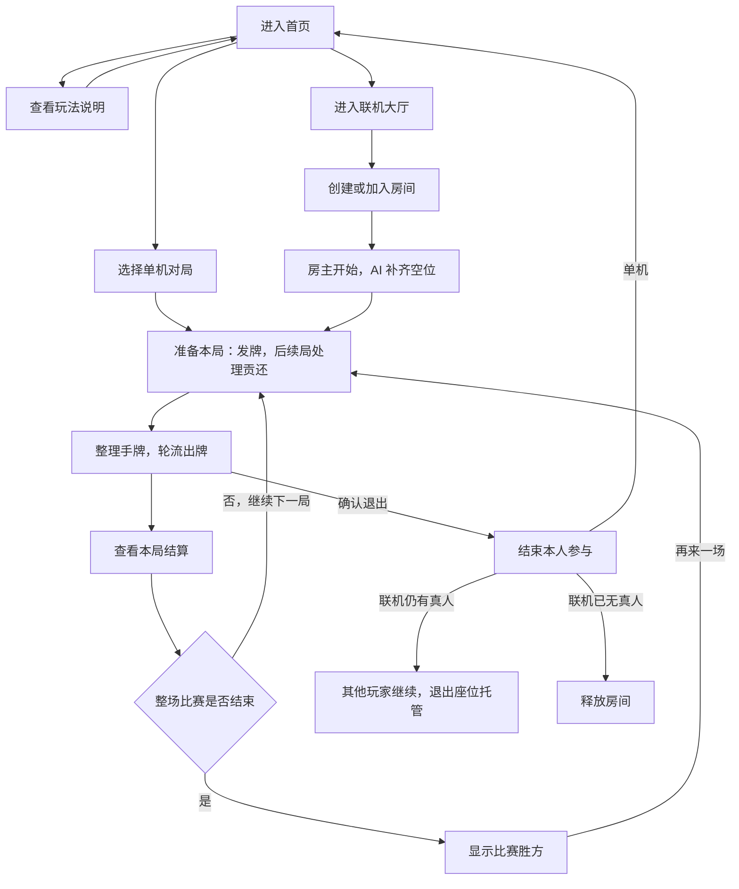

# 欢乐掼蛋用户需求说明书

| 文档项 | 内容 |
| --- | --- |
| 项目名称 | 欢乐掼蛋 Web 游戏 |
| 文档编号 | GD-URD |
| 文档版本 | V0.1 |
| 编写日期 | 2026-09-03 |
| 文档状态 | 课程设计需求草案，供需求评审与后续验收使用 |
| 适用范围 | 浏览器单机对局、好友房间联机及相关辅助功能 |
| 预期读者 | 项目开发者、测试人员、课程指导教师及参与需求评审的用户 |

## 1. 文档目的与依据

本文从用户角度说明系统应解决的问题、允许用户完成的操作、采用的玩法约定和可检查的验收条件，为后续系统设计、开发、测试及课程答辩提供依据。

本版依据项目现有页面、规则与对局实现、自动化测试、README、开发进度以及 2026-09-03 的项目评审整理。尚未开展用户访谈、问卷或教师需求确认，不将功能推断写成真实调研结论，也不将已有实现视为已经通过全部需求验收。

需求正文描述目标行为；第 10 节记录当前实现差距；第 11 节记录需要进一步确认的事项。性能数值为本版拟定的课程验收目标，尚无对应测量报告。本文不限定前端框架、通信协议、类结构或数据库方案，具体技术选择由设计文档说明。

### 1.1 编号与优先级

| 标记 | 含义 |
| --- | --- |
| UG | 用户目标 |
| FR | 功能需求 |
| BR | 业务规则 |
| NFR | 非功能需求 |
| UC | 典型用例 |
| AT | 验收场景 |
| GAP | 当前实现或验证差距 |
| D | 待确认事项 |
| M：必须 | 本课程设计核心交付应满足；未满足时应列出缺陷及影响 |
| S：应有 | 改善使用体验或质量的目标；是否纳入最终交付以需求评审结果为准 |

优先级表示需求的重要程度，不表示当前完成情况。后续修订应保留需求编号；删除的编号不重复使用。

## 2. 项目背景与用户目标

掼蛋需要四人结对参与，线下组织通常受到人数、时间和地点限制。新玩家还需要理解逢人配、进还贡、接风及升级规则。系统拟提供免注册的浏览器入口，使玩家可以独自练习，也可以通过房间号邀请好友，并由系统裁决规则、维护进度和显示结果。

| 编号 | 用户目标 | 成功表现 |
| --- | --- | --- |
| UG-01 | 无需凑齐四名真人即可练习 | 从首页发起单机对局，系统补齐三名 AI，能够完成比赛 |
| UG-02 | 与指定好友方便地组局 | 通过同一服务地址及房间号进入同一牌桌，人数不足时可使用 AI |
| UG-03 | 按一致规则公平地完成比赛 | 非法操作被拒绝，合法操作得到一致裁决，进贡与升级结果可解释 |
| UG-04 | 在电脑或手机上读牌、选牌和整理手牌 | 能辨认牌面、选择牌组、切换视图，关键操作不被遮挡 |
| UG-05 | 理解对局进度并处理继续、退出及掉线 | 能识别轮次、队伍、结算和托管状态，其他玩家离开后仍可继续 |

## 3. 用户角色与使用条件

### 3.1 角色

| 角色 | 主要诉求 | 权限或职责 |
| --- | --- | --- |
| 访问者 | 了解规则、选择模式 | 查看玩法说明，进入单机或联机入口 |
| 单机玩家 | 独自练习与体验完整比赛 | 操作自己的手牌，整理牌组，继续或退出比赛 |
| 联机玩家 | 与好友共同比赛 | 创建或加入房间，操作本人座位，查看公开信息，继续或退出比赛 |
| 房主 | 在开局前组织牌桌 | 拥有联机玩家权限；额外允许开局前添加、移除机器人及开始游戏 |
| 服务运行者 | 为课程演示或好友提供访问地址 | 启动与停止服务、告知地址及运行限制；不要求提供独立管理后台 |

AI 是系统提供的自动参与者，不是需要登录的外部用户。其承担单机陪玩、联机补位和离线托管职责，使用相同的出牌规则。

### 3.2 前提与约束

1. 用户已能访问服务运行者提供的页面地址，并允许页面执行必要的浏览器功能。
2. 单机指无需其他真人参与。首次加载仍需要可访问的页面服务；完全离线安装包和离线缓存不在本次交付范围。
3. 局域网联机要求参与者能访问同一服务实例。公网访问依赖运行者提供的网络入口，不将第三方隧道的可用性作为游戏自身承诺。
4. 每桌固定四个座位，允许一至四名真人，空缺座位由 AI 补齐。座位按进入顺序分配，对家结队，本版不提供自由换座。
5. 用户不需要注册账号。昵称只用于显示，不作为身份凭据，不要求全局唯一。
6. 本版没有断线重连、真人操作倒计时或在线挂机超时托管。网络未被判定断开且玩家未操作时，系统等待该玩家。
7. 单机页面刷新会失去当前进度；联机页面刷新按离开原连接处理，原座位转为 AI，玩家不能重新接管该座位。服务重启会丢失内存中的房间和比赛进度。

## 4. 产品范围

### 4.1 本次交付范围

首页与规则说明、单机对局、昵称与房间管理、AI 补位、选牌与出牌裁决、出牌提示、横排与分组视图、一键组牌、手动理牌、贡还交互、对局信息、升级结算、继续比赛、主动退出、掉线托管，以及支撑上述功能的基本可靠性和输入保护。

### 4.2 后续候选功能

账号体系、好友列表、聊天与表情、排行榜、历史战绩、对局存档与回放、断线重连、观战、匹配大厅、房间密码、自由换座、全员准备机制、AI 难度选择、长期公网运营和大规模并发服务均不属于本版必须完成的功能。纳入后续版本时应单独建立需求与验收条件。

### 4.3 主要用户流程

“再来一场”从双方打 2 的新比赛开始；“下一局”保留当前比赛等级。单机退出后停止本地对局，联机退出时由 AI 接管原座位。

## 5. 功能需求

### 5.1 进入系统与组织房间

| 编号 | 优先级 | 用户需求 | 验收条件 |
| --- | --- | --- | --- |
| FR-01 | M | 用户应能在首页选择单机、好友联机或玩法说明，并在关闭说明后继续使用首页 | 无需登录即可进入三类入口；说明包含牌型、逢人配、贡还、首出、接风与升级；关闭说明不会启动比赛 |
| FR-02 | M | 用户应能一键发起本人加三名 AI 的完整单机比赛 | 开始后出现四个座位、本人 27 张手牌及当前行动者；AI 自动处理其回合和贡还；用户能完成一局并继续 |
| FR-03 | M | 联机用户应能填写昵称，留空时获得默认昵称 | 本版以最多 8 个字符作为昵称长度目标；空白输入生成非空默认昵称；大厅和牌桌显示一致；昵称按普通文本显示，超限输入不得造成异常。计数口径见 D-03 |
| FR-04 | M | 用户应能创建房间或输入四位数字房间号加入尚有空位、尚未开始的房间 | 创建成功后展示房间号并占据一个座位；加入成功后所有成员看到相同座位列表；号码格式错误、房间不存在、已满或已开始时给出相应提示且不改变原房间状态 |
| FR-05 | M | 房主应能在开局前管理机器人，所有成员应能区分真人、机器人、本人和房主 | 房主可向空座添加机器人、移除机器人；普通成员不能执行这些管理操作；不提供移除真人功能；房主开局前离开时，权限转交给仍在房间中的真人 |
| FR-06 | M | 房主应能在至少有本人参与时开始游戏，无需手工补满四人 | 系统补齐空座后仅开始一场比赛；其他成员不能代替房主开局；开局后禁止新成员加入和修改机器人配置；各端进入同一局 |

### 5.2 操作与整理手牌

| 编号 | 优先级 | 用户需求 | 验收条件 |
| --- | --- | --- | --- |
| FR-07 | M | 玩家应能选牌、取消选择、重选、出牌或不出，并得到合法性裁决 | 仅当前行动者可以出牌或不出；首出者不能不出；成功后只扣除实际提交的独立牌并转移行动权；无牌、重复牌、非本人牌、不合法牌型或压不过时拒绝操作，手牌和行动权保持原样 |
| FR-08 | M | 玩家应能通过提示寻找合法出法，提示不得替玩家直接提交 | 领出时给出合法牌组；跟牌时如存在合法出法，应至少找到一种，允许在候选中切换；确实没有合法跟牌时明确提示；提示选中的牌可以直接合法提交；三带二案例见 AT-04 |
| FR-09 | M | 玩家应能在横排和按点数分组的手牌视图间切换 | 两种视图显示相同手牌；切换本身保留当前选择和手动牌组；横竖屏切换后牌面、数量和选择状态不丢失；浏览器存储可用时记住视图偏好 |
| FR-10 | S | 玩家应能一键整理手牌，并恢复普通排列 | 优先保留炸弹类组合并减少余牌手数；每张手牌恰好属于一个显示分组，每组都是合法出法；分组视图显示组合标签；再次操作可还原；不承诺获得数学上的全局最优拆分 |
| FR-11 | M | 玩家应能暂存多个合法牌组，整组选中、取消或放回普通手牌区 | 暂存组至少两张且构成合法牌型；不同组不重复使用同一张牌；非法分组给出提示；部分牌打出或移交后，对应不完整组自动解散；一键组牌期间暂时隐藏手动组，还原后保留仍有效的组 |
| FR-12 | M | 需要贡还的玩家应能理解当前任务并确认指定牌；贡还阶段仍可整理手牌 | 最大贡牌存在多花色选择时允许本人选择，否则自动处理；手动贡还必须单选一张合法牌并明确确认；允许重选；多选或选非法牌不能提交，但不妨碍整理；所有贡还完成前不得进入正常出牌 |

### 5.3 获取信息与继续比赛

| 编号 | 优先级 | 用户需求 | 验收条件 |
| --- | --- | --- | --- |
| FR-13 | M | 玩家应能知道本人位置、队友、当前行动者、已出牌和比赛进度 | 本人始终位于牌桌下方；对家标识为队友；显示局数、当前级牌及双方等级、独立 A 阶段；出牌、不出、名次和约定公开的贡还信息可辨认；别人剩余手牌不多于 10 张时显示数量 |
| FR-14 | M | 每局及整场结束后，玩家应能查看名次、结果和下一步选择 | 本局结算显示四家名次、获胜队伍、升级结果、A 阶段变化和剩余手牌；整场结束时明确显示胜方；已结束的局不再接受出牌 |
| FR-15 | M | 玩家应能在结算后继续下一局或开始新比赛 | 单机由本人发起；联机任一仍在线成员可发起，第一次有效请求生效，其他客户端同步进入；下一局沿用等级并处理贡还，再来一场重置双方等级与 A 阶段。本版没有全员准备流程 |

### 5.4 退出、断开与资源释放

| 编号 | 优先级 | 用户需求 | 验收条件 |
| --- | --- | --- | --- |
| FR-16 | M | 用户应能离开等待房间，或确认退出正在进行的对局 | 等待房间退出后释放座位；对局退出先确认，取消则继续；单机确认后停止 AI 并返回首页；联机确认后原座位托管，其他成员继续 |
| FR-17 | M | 联机玩家掉线后，其他成员应能识别其托管状态并继续对局 | 服务确认连接关闭后标记托管，AI 从该座位下一次需要行动时接手；离线方在能够收到断开通知时得到提示；刷新或重新打开页面不恢复原座位控制权 |
| FR-18 | M | 用户的重复建房、重复加入或离开操作不应产生虚假成员或无人占用的残留房间 | 同一连接最多占一个房间中的一个座位；已在房间时重复进入应拒绝或返回现有房间，不额外占座；最后一个真人离开后释放房间并停止其自动对局，原房间号不再对应该场比赛 |

### 5.5 反馈与会话重置

| 编号 | 优先级 | 用户需求 | 验收条件 |
| --- | --- | --- | --- |
| FR-19 | S | 玩家应获得选牌、出牌、炸弹与结算等反馈，并能在无声音时理解结果 | 声音不可用时游戏仍可操作；重要结果均有文字或视觉标识；不以音效作为判断当前状态的唯一方式 |
| FR-20 | M | 玩家开始新比赛或在单机、联机之间切换时，应获得正确的新会话界面 | 清除上一场的选择、手动牌组、一键组牌结果和事件显示记录；不将新手牌归入旧牌组；可保留个人视图偏好 |

## 6. 业务规则与术语

以下是本项目采用的玩法约定，用于保证需求与验收口径一致，不声明兼容所有地方玩法或赛事规则。涉及未冻结边界的内容见第 11 节。

### 6.1 术语

| 术语 | 定义 |
| --- | --- |
| 一局／一手 | 从发牌、必要的贡还到本次名次结算的过程；本文统一称“一局” |
| 一场比赛 | 从双方打 2 开始，经过若干局，直到一方成功打过 A |
| 一轮牌 | 一方领出后，其他未出完玩家依次跟牌或不出，直到确定下一次领出者 |
| 级牌 | 当前局约定的等级点数；同一局只存在一种级牌点数 |
| 逢人配 | 红桃级牌，可在组合中代替除王以外的牌 |
| 头游、二游、三游、末游 | 本局结算的第一至第四名 |
| 双下 | 头游队伍包揽前两名，另一队两名玩家均在后两名 |
| 接风 | 已出完者的最后一手未被压过时，由其仍在出牌的队友获得领出权 |
| 托管 | AI 接替已经离开的真人座位，保留该座位的手牌及队伍关系 |

### 6.2 牌、队伍与牌型

| 编号 | 业务规则 |
| --- | --- |
| BR-01 | 使用两副含大小王的牌，共 108 张；每局初始每人 27 张。四人固定按桌面顺序行动，对家为一队。同花色同点数的两副牌仍是两张独立的牌 |
| BR-02 | 双方从 2 开始，等级依次为 2 至 10、J、Q、K、A。首局打 2；之后由上一局头游所在队的当前等级决定本局级牌 |
| BR-03 | 普通比较次序为大王、小王、级牌、A、K、Q、J、10 至 3、2，由大到小。级牌不在末尾自然点数位置重复计算。红桃级牌单出时按级牌计算，组合时可配除王以外的牌 |
| BR-04 | 系统接受下表列出的牌型；王仅可单出、同种王组成对子，或以两张大王加两张小王组成四大天王。其他牌型不得用王代替普通牌 |
| BR-05 | 顺子固定五张；三连对固定三个连续点数的对子；钢板固定两个连续点数的三张。序列使用 A—2—3—…—K—A 的连续窗口：A2345、AA2233、AAA222 合法且最小；KA234、KKAA22 非法；级牌按自然点数参与序列 |
| BR-06 | 普通跟牌必须与目标牌型、张数相同且更大，三带二按三张部分比较。炸弹可压普通牌；炸弹次序为四大天王、大于等于六张炸弹、同花顺、五张炸弹、四张炸弹。同类同张数比较点数或序列高低，六张以上炸弹先比较张数。能组成同花顺的同一组牌不降格为普通顺子；同一组牌有多个三带二解释时采用三张点数较大的解释 |

| 牌型 | 张数 | 构成 |
| --- | --- | --- |
| 单张 | 1 | 任意一张 |
| 对子 | 2 | 同点数两张，或两张同种王 |
| 三张 | 3 | 同点数三张 |
| 三带二 | 5 | 三张同点数加另一点数的对子 |
| 顺子 | 5 | 五个连续点数，且不构成同花顺 |
| 三连对 | 6 | 三个连续点数，各两张 |
| 钢板 | 6 | 两个连续点数，各三张 |
| 炸弹 | 至少 4 | 同点数普通牌，可使用合法逢人配 |
| 同花顺 | 5 | 同花色五个连续点数，可使用合法逢人配 |
| 四大天王 | 4 | 两张大王与两张小王 |

### 6.3 行动、贡还与胜负

| 编号 | 业务规则 |
| --- | --- |
| BR-07 | 首局首出者随机确定。轮流出牌时跳过已出完玩家；领出者必须出牌，跟牌者可以不出。其余仍在出牌者全部不出后，由最后出牌者再次领出；该玩家已出完时由其未出完的队友接风。需要兜底时取下一位仍有牌的玩家 |
| BR-08 | 首局不贡还。后续单下由末游向头游进贡；双下按本项目现行配对由末游向头游、三游向二游进贡。贡牌是最大非逢人配牌；有同点多花色普通牌可选时由贡方决定花色，王或唯一花色则自动处理。收到贡牌者向对应贡方还一张牌面不大于 10 的非王牌、非逢人配牌，2 可还。无合法还贡牌的情况见 D-02 |
| BR-09 | 单贡方持有两张大王，或双贡双方合计持有两张大王时抗贡；该局免进贡和还贡，并公开相关大王持有信息 |
| BR-10 | 贡还全部完成后由进贡牌最大者首出；单贡时即末游首出；双贡同大时由上一局头游的上家首出。抗贡时由上一局头游首出 |
| BR-11 | 一队两人全部出完，或已有三人出完时进行本局结算。头游所在队获胜，队友为二游、三游、末游时分别升 3、2、1 级，最高到 A。双下时未出完两人的名次口径见 D-01 |
| BR-12 | 两队独立维护 A1、A2、A3。本局实际打 A 的队伍，必须取得头游且队友非末游才算过 A，并赢得整场比赛；失败推进本队 A 阶段，A3 失败后回到 2。另一队等级及 A 阶段独立保留；另一队取得头游时按适用规则升级。在对方级牌局获胜不能直接视为本队过 A |
| BR-13 | 玩家界面默认仅展示本人未公开手牌；出牌、贡牌、还贡、抗贡信息和名次为公开信息；别人剩余牌数不大于 10 时在界面报牌；结算后公开各家剩余手牌。此处报牌限制描述界面展示，不要求隐藏通信中的牌数统计；联机时不得发送其他玩家尚未公开的具体手牌 |

## 7. 典型用例

### UC-01：开始并体验单机对局

- **参与者：** 单机玩家。
- **前置条件：** 页面已加载，用户位于首页。
- **触发：** 点击单机入口。
- **正常流程：** 系统建立四人牌桌并安排三名 AI；按规则发牌；显示本人手牌和行动者；AI 自动行动；轮到本人时展示操作入口；本局结束后展示结算。
- **异常或替代流程：** 玩家提交非法牌组时保留对局状态并提示原因；玩家确认退出时结束本地参与。
- **后置条件：** 到达结算页，或按本人意愿结束对局。
- **关联需求：** FR-01、FR-02、FR-07、FR-13、FR-14、FR-16。

### UC-02：邀请好友并开局

- **参与者：** 房主、联机玩家。
- **前置条件：** 成员能访问同一服务；均未占用其他房间座位。
- **触发：** 一人创建房间。
- **正常流程：** 房主获得房间号并告知好友；好友填写昵称和房间号加入；各成员查看座位及队伍；房主按需配置机器人并开始；系统补齐剩余空位，向成员展示同一局的各自可见状态。
- **异常或替代流程：** 房间不存在、已满、已开始时拒绝加入；普通成员管理机器人或开始游戏时不改变房间；房主开局前离开时转交权限；同一连接重复进入不额外占座。
- **后置条件：** 成员进入同一牌桌，或留在可继续操作的大厅。
- **关联需求：** FR-03、FR-04、FR-05、FR-06、FR-18。

### UC-03：跟牌或选择不出

- **参与者：** 当前行动的玩家。
- **前置条件：** 已进入出牌阶段；界面显示待跟牌型或领出状态。
- **触发：** 用户手动选牌或点击提示。
- **正常流程：** 用户选择一组牌；系统显示选择状态；用户点击出牌；系统校验牌的归属、唯一性、牌型及大小；成功后移除这些牌并更新桌面与行动者。
- **异常或替代流程：** 用户可以取消、重选或在允许时不出；非法输入只提示原因，不扣牌、不推进回合；提示只改变选择，不自动出牌。
- **后置条件：** 合法操作推进对局，或仍停留在该玩家的有效回合。
- **关联需求：** FR-07、FR-08，BR-03 至 BR-07，NFR-01、NFR-02。

### UC-04：整理手牌

- **参与者：** 尚有手牌的玩家。
- **前置条件：** 处于出牌或贡还阶段。
- **触发：** 切换视图、点击一键组牌或手动理牌。
- **正常流程：** 用户选择适合的视图；将合法组合暂存为独立牌组；通过组标签整组选牌，或将组放回；也可使用一键组牌并还原。
- **异常或替代流程：** 非法组合不能暂存；一张牌不能同时属于两个手动组；一键组牌期间隐藏手动组；已出牌或已贡还导致不完整的组解散。
- **后置条件：** 手牌数量及所有权不变，显示方式或有效分组更新。
- **关联需求：** FR-09、FR-10、FR-11、FR-12，NFR-01、NFR-06。

### UC-05：选择贡牌与还贡

- **参与者：** 需要进贡或还贡的玩家；其他成员旁观公开过程。
- **前置条件：** 已完成上一局；新局需要贡还且不满足抗贡。
- **触发：** 系统提示本人选择贡牌或还贡。
- **正常流程：** 系统说明当前任务；用户可先整理手牌；单选合法牌并查看确认信息；用户确认；系统更新双方手牌并公开结果；全部完成后按规则确定首出者。
- **异常或替代流程：** 单一贡牌选择自动处理；多选或非法单选不允许确认；重选保留原手牌；需要操作的真人离线则由 AI 接手；抗贡直接进入出牌阶段。
- **后置条件：** 贡还任务减少或完成，牌的总数不变。
- **关联需求：** FR-11、FR-12、FR-17，BR-08、BR-09、BR-10；无合法还贡牌的例外由 D-02 冻结后补充。

### UC-06：查看结果并继续

- **参与者：** 单机玩家或仍在线的联机成员。
- **前置条件：** 本局或整场已经结算。
- **触发：** 查看结算并点击下一局或再来一场。
- **正常流程：** 用户查看四家名次、剩余手牌和等级变化；发起继续；系统开始下一局或重置为新比赛；清除上一场不应保留的界面状态。
- **异常或替代流程：** 联机多个成员同时请求继续时仅生效一次；本版一人发起即可继续，其他成员不需要逐一确认；出牌阶段不能提前开始下一局。
- **后置条件：** 所有在线成员位于同一新局，各自手牌信息仍然隔离。
- **关联需求：** FR-14、FR-15、FR-20，BR-11、BR-12。

### UC-07：离开或断开连接

- **参与者：** 离开的玩家、仍在线成员。
- **前置条件：** 已加入房间或正在对局。
- **触发：** 主动离开、确认退出，或服务识别到连接关闭。
- **正常流程：** 等待阶段释放座位并按需转交房主；对局阶段改为 AI 托管，其他成员继续；最后一个真人离开后释放房间。
- **异常或替代流程：** 取消退出则不改变状态；重复退出不造成额外修改；掉线玩家重新访问时不能接管原座位；尚未被识别的网络中断不等同于已经完成托管。
- **后置条件：** 剩余成员状态一致，没有虚假在线座位或无人房间持续运行。
- **关联需求：** FR-16、FR-17、FR-18，NFR-03、NFR-04。

## 8. 非功能需求

### 8.1 正确性、可靠性与信息保护

| 编号 | 优先级 | 需求与验收口径 |
| --- | --- | --- |
| NFR-01 | M | 对局中不得凭空新增、复制或丢失牌；贡还只转移归属，出牌只消耗一次。按全部当前手牌与本局已出牌记录核对时，应恰好覆盖原有 108 张独立牌。非法操作前后手牌、当前行动者、贡还任务、名次和等级均不变 |
| NFR-02 | M | 联机玩家只能操作本人的有效座位；系统统一裁决操作。结算前接收的信息不含其他成员未公开的具体手牌。AI 决策只使用本座位手牌及允许获得的公开信息；单机不以防止本机调试修改为验收目标 |
| NFR-03 | M | 单个格式异常的请求或连接错误不得使全部房间停止服务；异常应被拒绝或只结束该连接。同一服务中另一个正常房间仍能提交动作并得到响应 |
| NFR-04 | M | 用户输入不得改变页面结构或执行内容；重复加入和离开不得产生额外座位；未公开文件不能通过页面地址读取；最后一名真人离开后，原房间不得继续占用活动对局资源 |
| NFR-05 | M | 不同房间的玩家列表、手牌、操作和结算相互隔离。至少同时建立两个房间并在其中一个出牌、退出、开始下一局，另一个房间不得发生相应状态变更 |
| NFR-09 | M | 系统能够连续完成一场比赛及下一场的开始。固定种子的 30 场自动模拟应正常结束并检查 NFR-01；正常联机验收应连续完成两局且没有非预期操作错误。定向构造贡还与抗贡，不能依赖随机两局恰好触发全部特殊情形 |

### 8.2 易用性、兼容性与响应

| 编号 | 优先级 | 需求与验收口径 |
| --- | --- | --- |
| NFR-06 | M | 在桌面 1440×900、手机横屏 932×390、手机竖屏 390×844 的 CSS 视口下，玩家能读取手牌并完成出牌、贡还和结算继续；关键按钮不被手牌遮挡或排到不可操作区域；旋转屏幕不丢失选择与有效牌组。视口验收应在真实浏览器中进行 |
| NFR-07 | S | 以课程演示所用桌面浏览器，以及 Android Chrome 或 iOS Safari 中至少一种移动浏览器作为兼容性目标；验收报告记录具体操作系统、设备和浏览器版本。只在某一桌面浏览器通过，不视为移动端兼容性通过 |
| NFR-08 | S | 在同一局域网、一个四人房间、默认 AI 延迟、无网络限速的验收环境中：选牌与重选反馈不超过 200 ms，一键组牌反馈不超过 1 s，合法联机动作到其他客户端显示更新不超过 2 s，AI 从轮到行动到完成操作不超过 3 s。每类至少测量 30 次，至少 95% 样本达标；记录设备、版本和网络条件。以上是拟定目标，尚未测量 |
| NFR-10 | S | 支持鼠标和触摸选牌；键盘可聚焦手牌及主要按钮，并用 Enter 或空格激活；选择状态及队伍关系不能只依赖颜色区分；系统偏好减少动态效果时应减弱动画，且不影响操作。声音不可用或浏览器存储不可用时，核心流程仍可完成 |

### 8.3 数据边界

| 数据 | 用户可见范围 | 保存约定 |
| --- | --- | --- |
| 昵称、头像、房间号和座位类型 | 同房间成员 | 随当前房间存在；不作为永久账号资料 |
| 本人未公开手牌 | 该座位及负责裁决的系统 | 当前对局使用，不提供用户历史查询 |
| 他人未公开手牌 | 联机客户端不应获得 | 结算后才按规则公开剩余牌 |
| 出牌、贡还、名次、等级与结果 | 当前对局成员 | 当前比赛使用；本版不提供长期战绩 |
| 手牌视图偏好 | 当前浏览器用户 | 浏览器存储允许时跨页面刷新保存；清理浏览器数据后可恢复默认 |

## 9. 验收与需求追踪

本节给出验收计划，不代表已经全部执行。验收时记录需求编号、前置数据、操作步骤、预期结果、实际结果、通过情况和关联缺陷。特殊规则允许使用固定发牌或构造状态作为测试辅助，但不要求向普通用户提供修改手牌入口。

### 9.1 验收场景

| 编号 | 场景与操作 | 必须观察的结果 |
| --- | --- | --- |
| AT-01 | 从首页查看并关闭规则，开始单机；完成一局后继续，再确认退出 | 三类入口可用；三名 AI 参与；规则、操作、结算与退出连贯；退出后本地 AI 不再行动 |
| AT-02 | 三个浏览器会话创建、加入同一房间；测试留空昵称和长度边界；普通成员尝试管理，房主配置 AI 后开始 | 昵称与房间信息一致；只有房主能管理和开局；最终四席；错误号码、满房、已开局加入均得到正确处理 |
| AT-03 | 在固定牌局依次提交合法单张、对子、三带二、顺子、三连对、钢板和各层级炸弹，并尝试非法跟牌及领出时不出 | 牌型、大小与行动顺序符合 BR-01 至 BR-07；非法动作不改状态；包含王的使用限制和同花顺不可降格案例 |
| AT-04 | 打 2，手牌包含两张 A、两张 7 和一张红桃 2，跟对手的三 K 带一对；分别手选和使用提示，并测试 AI 面对同一局面 | 手选和提示都能采用三 A 带对 7 合法跟牌；AI 在这五张为全部手牌时能够一手出完；不得出现手选能出而提示报告无牌的分歧 |
| AT-05 | 同一手牌切换横排和分组，暂存多个牌组、一键组牌并还原、部分出牌、旋转屏幕 | 所有牌完整且不重复；有效手动组可恢复；不完整组解散；切换视图和旋转保持选择；分组标签与实际牌型一致 |
| AT-06 | 固定构造单贡、双贡、最大牌多花色、贡牌同大及抗贡；多选整理后单选并确认贡还 | 贡还合法且公开；错误选择不提交；手动组不妨碍确认；全部贡还结束后才进入出牌，首出者正确。D-01、D-02 确认后补齐对应边界数据 |
| AT-07 | 固定构造接风、头游与不同队友名次、两队交替级牌及 A1/A2/A3 成败，再发起下一局和新比赛 | 接风、升级、A 阶段和比赛胜方正确；结算剩余牌可见；下一局保留等级、新比赛重置；多个继续请求不重复开局 |
| AT-08 | 房主在等待时离开；比赛中成员主动退出和关闭连接；最后一名真人离开；重复建房、加入和退出 | 房主正确转交；已开局座位由 AI 接手；无虚假在线成员；空房间释放；重复操作不额外占座；原玩家无法通过刷新重接管 |
| AT-09 | 用辅助测试提交重复牌标识、非本人牌、缺失动作内容及其他非法输入 | 返回错误或拒绝处理，手牌、名次、等级、行动权及贡还任务不变；合法客户端可继续 |
| AT-10 | 两个房间同时运行；向测试服务发送异常 URL、异常连接数据，尝试读取非公开文件，输入含标记的昵称 | 服务继续运行；其他房间不受影响；不返回非公开文件；昵称仅作为文本；观察到房间间状态隔离 |
| AT-11 | 在规定的三个视口及选定浏览器中完成核心操作，使用键盘、禁用声音与浏览器存储，并启用减少动态效果 | 手牌和按钮可操作，信息不依赖音效或颜色，视图切换、贡还、结算继续可完成；记录实际环境与例外 |
| AT-12 | 在约定环境中分别采集选牌、组牌、联机同步和 AI 行动时延 | 按 NFR-08 的样本数和阈值计算达标比例，保留数据；未测量不填写为通过 |
| AT-13 | 固定种子完成 30 场模拟；联机完成两局；检查每次操作后的牌张与状态 | 无非法状态、无牌张丢失或重复；非预期服务端错误导致测试失败；仅完成比赛不足以单独证明正确性 |
| AT-14 | 结束或退出单机后进入联机，再开始新比赛；切换前使用手动和自动组牌 | 不残留旧场选择、牌组及事件显示；新牌桌成员与队伍正确；视图偏好可以保留 |
| AT-15 | 在联机非结算阶段检查各座位收到的信息，再进入结算；检查 AI 决策输入 | 未泄露他人未公开具体手牌；公开信息与 BR-13 一致；结算才公开剩余手牌；AI 不读取其他座位隐藏手牌 |

### 9.2 用户目标与需求对应

| 用户目标 | 功能需求 | 相关质量需求 | 验收场景 |
| --- | --- | --- | --- |
| UG-01 独自练习 | FR-01、FR-02、FR-14、FR-15 | NFR-01、NFR-08、NFR-09 | AT-01、AT-07、AT-12、AT-13 |
| UG-02 好友组局 | FR-03、FR-04、FR-05、FR-06、FR-18 | NFR-03、NFR-04、NFR-05 | AT-02、AT-08、AT-10 |
| UG-03 规则公平 | FR-07、FR-08、FR-12、FR-14 | NFR-01、NFR-02、NFR-09 | AT-03、AT-04、AT-06、AT-07、AT-09、AT-13、AT-15 |
| UG-04 读牌与理牌 | FR-09、FR-10、FR-11、FR-19 | NFR-06、NFR-07、NFR-08、NFR-10 | AT-05、AT-11、AT-12 |
| UG-05 进度与连续性 | FR-13、FR-15、FR-16、FR-17、FR-18、FR-20 | NFR-02、NFR-03、NFR-04、NFR-05、NFR-09 | AT-07、AT-08、AT-10、AT-13、AT-14、AT-15 |

### 9.3 现有测试资产

下列文件可作为后续验收的基础；“已有测试”不等于覆盖该组所有需求。业务规则变更时应同时更新测试与本文。

| 关注内容 | 现有材料 | 还需注意 |
| --- | --- | --- |
| 牌型、贡还、接风、等级 | [规则测试](../test/rules.test.js)、[引擎测试](../test/engine.test.js)、[贡还界面测试](../test/tribute.test.js) | 补充非法动作、枚举完整性及未冻结规则的案例 |
| AI 决策 | [AI 定向测试](../test/ai.test.js) | 策略胜率不能替代合法性与可见信息范围验证 |
| 自动与手动理牌 | [自动组牌测试](../test/arrange.test.js)、[手动组牌测试](../test/manual-group.test.js)、[贡还理牌测试](../test/manual-tribute.test.js) | 保持完整覆盖、无重复和组合合法性检查 |
| 页面交互与布局 | [布局测试](../test/card-layout.test.js)、[UI 冒烟](../test/ui.smoke.js) | 自动 DOM 检查不能替代真实浏览器视口、触摸与兼容性验收 |
| 比赛与联机 | [整场模拟](../test/simulate.js)、[联机测试](../test/e2e.js) | 增加牌张不变量检查，并将非预期服务端错误判为失败 |

### 9.4 完成判定

本版仍是草案，不能据此宣称产品已经验收完成。需求评审冻结后，所有 M 级需求应有验收记录；阻碍核心流程、破坏牌张状态、泄露未公开信息或使全服务退出的缺陷应修复并回归；S 级项目应明确已验收、未通过或延期。延期需求、待确认规则及已知限制须在课程报告中如实说明。

## 10. 当前实现差距

以下是本次需求整理所依据的现状记录，不是对目标需求的放宽，也不表示本次文档工作已修复代码。

| 编号 | 相关需求 | 当前情况 | 后续完成条件 |
| --- | --- | --- | --- |
| GAP-01 | FR-07、NFR-01 | 2026-09-03 评审已复现：重复提交同一张牌的标识可被接受为对子，并误删另一张手牌 | 拒绝重复牌，失败时状态不变，AT-09 及牌张守恒检查通过 |
| GAP-02 | NFR-03 | 同次评审已复现：异常 URL 和非法 WebSocket 文本帧分别导致测试服务进程退出 | 异常仅影响对应请求或连接，AT-10 通过 |
| GAP-03 | NFR-04 | 同次评审已复现：静态路径可读取服务端源码 | 公开内容与非公开文件访问边界明确，AT-10 通过 |
| GAP-04 | FR-18、NFR-04 | 同次评审已复现：重复建房后有旧座位残留，已开局的无人房间没有释放路径 | 连接只占一个座位，空房停止并释放，AT-08 通过 |
| GAP-05 | FR-08 | 同次评审已复现：AA77 加红桃级牌组成的三带二可手动出牌，但提示与 AI 的出牌枚举遗漏该组合 | 手选、提示与 AI 对该局面一致，AT-04 通过，并增加同类边界案例 |
| GAP-06 | NFR-09 | 联机测试出现“还没轮到你”仍报告通过；整场模拟主要检查动作成功和比赛结束，未逐步检查全部牌张不变量 | AT-13 的异常判定和状态检查真正执行，而非仅输出日志 |
| GAP-07 | FR-03 | 页面昵称输入最多 8 个字符，服务端目前截取上限为 12，长度口径不一致；姓名显示包含 HTML 拼接 | 按 D-03 冻结的口径统一校验；文本显示验收通过；不将尚未验证的脚本执行风险写为已经复现 |
| GAP-08 | NFR-06、NFR-07、NFR-08、NFR-10 | 已有布局、交互测试及历史人工验收记录；本轮未执行跨浏览器、真机和响应时间测量 | 补充与最终版本对应的 AT-11、AT-12 记录，列明设备、版本、数据和日期 |

## 11. 假设与待确认事项

需求整理先按现有产品范围形成可评审草案，下列事项不阻止继续编写设计和测试计划；涉及规则或阈值的最终验收前，应记录决策并修订受影响条目。

| 编号 | 待确认事项 | 当前依据或草案建议 | 影响 |
| --- | --- | --- | --- |
| D-01 | 双下时尚未出完的两名玩家如何排列三游和末游，以及双贡接收关系是否采用当前方案 | 当前实现按固定座位顺序补齐未出完名次，并采用末游向头游、三游向二游的配对；这不是两人真实出完的先后。需确认该课程版本接受这一玩法约定，或定义替代规则 | BR-08、BR-11、AT-06、AT-07 |
| D-02 | 收贡后没有任何不大于 10 的非王、非逢人配牌时如何还贡 | 当前只允许规定范围的还牌，项目说明尚未定义无合法候选时的处理办法；不擅自加入重发或放宽牌点规则 | FR-12、BR-08、UC-05、AT-06 |
| D-03 | 昵称“字符”如何计数，特别是表情和组合字符 | 暂以 8 个字符为长度目标；课程基本用例覆盖中文、英文字母和数字。开发前统一扩展字符的计数和提示方式，不沿用两端不同限制 | FR-03、AT-02、GAP-07 |
| D-04 | 教师是否指定文档模板、玩法标准、目标设备及必须完成的 S 级功能 | 当前采用项目现行玩法与本文建议的规模、设备和指标；收到任务书后核对，而不宣称已经获得教师确认 | 文档格式、业务规则、非功能目标和最终验收范围 |

本版明确沿用“任一在线成员可发起下一局”的现有行为。若改为房主控制或全员准备，应作为 FR-15 的需求变更记录，而不在实现时自行改变用户流程。

## 12. 维护与参考材料

需求变更应记录：变更原因、涉及编号、修改后的用户行为、影响的规则及验收场景、实现和测试状态。教师评审或用户反馈产生的新要求应进入修订记录，不将历史需求直接覆盖而不留痕。

| 版本 | 日期 | 修订内容 |
| --- | --- | --- |
| V0.1 | 2026-09-03 | 根据现有项目建立用户目标、范围、功能与质量需求、业务规则、典型用例、验收追踪、实现差距及待确认事项 |

参考材料：

- [项目说明与运行方式](../README.md)
- [开发进度与历史验证记录](../progress.md)
- [用户界面](../public/index.html)与[应用主控](../public/js/app.js)
- [规则实现](../shared/rules.js)与[对局引擎](../shared/engine.js)
- [联机房间实现](../server/index.js)

以上为项目内部依据，不作为外部规则标准、真实用户调研或最终验收报告。
